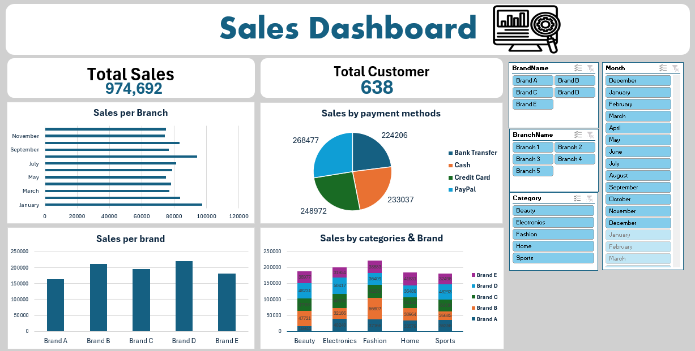

# Sales Data Analysis | Excel

An end-to-end sales analysis project built in Excel, from raw data to an interactive dashboard.

## Tools
Power Query, Power Pivot, PivotTables, Charts and Slicers.

## What I Did
- Cleaned and transformed 2023-2024 sales data using Power Query.
- Built a data model with Power Pivot across the Sales, Branches, Brands, Customers, Payment Methods and Products tables.
- Created an interactive dashboard to explore sales performance.

